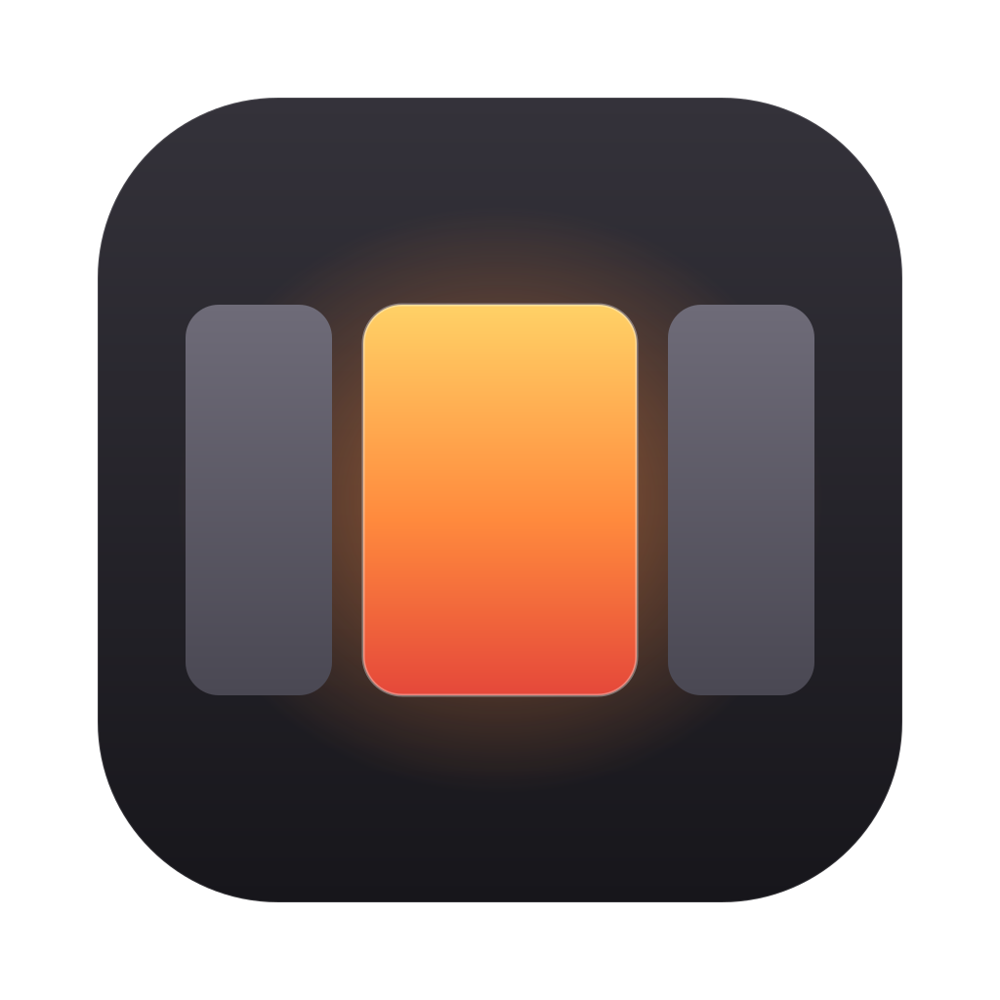

<p align="center">
  
</p>

<h1 align="center">Hephaestus</h1>

<p align="center">
  A FancyZones-style window manager for macOS.<br>
  Splits every screen into zones and snaps windows into them.
</p>

Hephaestus lives in your menu bar. By default each screen is divided into three zones: **left**, a **16:9 center**, and **right**. Drag a window to a zone, or use a hotkey, and it snaps into place. It's built for ultrawide monitors, where a maximized window is far too big.

> **Status:** early and in active development. See the [open issues](../../issues) for the roadmap toward FancyZones parity.

## Features

- Zones on **every connected screen**; narrow screens fall back to a 25/50/25 split
- **Built-in layouts** (Ultrawide 3-way, Focus, Columns, Rows, Grid, Priority Grid) and **custom layouts** from two editors: a grid editor (split, drag dividers, merge) and a free-form canvas editor. Import and export layouts as JSON
- **A layout per monitor**, remembered by display; separate defaults for landscape and portrait displays; optional **span across all screens** as one surface; per-layout gap
- **Drag to snap** with a live overlay: Hold Shift, click another mouse button to toggle, or always show zones while dragging
- **Multi-zone snapping**: drop near the edge between two zones, hold a modifier (Control by default), or middle-click to span several zones
- **Switch layouts fast**: number hotkeys per layout, the mouse wheel while dragging, and a name popup when the layout changes
- **Keyboard navigation**: snap to first/middle/last zone, step through zones, or move by position and expand across zones
- **Window memory**: restores a window's size when you drag it out of a zone, re-applies zones when displays or layouts change, puts new windows in their app's last zone
- **Cycle windows** stacked in one zone, and **rotate** all windows across monitors
- **Window eligibility**: dialogs, utility windows, sheets and fullscreen windows are left alone by default; exclude apps by name
- **Command line**: `hephaestus-cli` controls the running app
- Overlay options: show zones on all screens or only the one under the cursor, system or custom colors (follows light/dark mode), opacity, zone numbers
- **Global hotkeys** (no extra permissions beyond Accessibility)

## Requirements

- macOS 13 or later
- Command Line Tools (`xcode-select --install`). Full Xcode isn't needed.

## Build and run

```bash
git clone https://github.com/gianlucanotaro/hephaestus.git
cd hephaestus
./setup-signing.sh      # once: creates a local "Hephaestus Dev" signing certificate
./build.sh              # builds build/Hephaestus.app
open build/Hephaestus.app
```

Hephaestus is a menu bar app (no Dock icon). Quit it from its menu, or with `pkill -x Hephaestus`.

### Accessibility permission

Moving other apps' windows needs the Accessibility permission. On first launch, grant it in **System Settings → Privacy & Security → Accessibility**.

Run `./setup-signing.sh` once before your first build. Without it the app is ad-hoc signed, the signature changes on every rebuild, and macOS forgets the permission each time. The script creates a self-signed certificate in your login keychain and asks for your login password to trust it.

## Usage

### Default shortcuts

| Action | Default | Notes |
| --- | --- | --- |
| Snap the frontmost window to the left / center / right zone | ⌃⌥← / ⌃⌥↑ / ⌃⌥→ | Keyboard mode "Direct" (default) |
| Previous / next zone | ⌃⌥← / ⌃⌥→ | Keyboard mode "Zone index" |
| Nearest zone in a direction | ⌃⌥←↑→↓ | Keyboard mode "Relative position" |
| Expand the window's zone span in a direction | ⌃⌥⇧←↑→↓ | Keyboard mode "Relative position" |
| Preview the zones | ⌃⌥Z | |
| Next / previous window in the same zone | ⌃⌥Page Down / ⌃⌥Page Up | Setting, on by default |
| Apply layout number 0-9 to the screen under the cursor | ⌃⌥⌘0 ... ⌃⌥⌘9 | Assign numbers in Settings |
| Open the layout editor for the screen under the cursor | ⌃⌥⌘E | |
| Rotate windows across monitors | Hold ⌥X, press ← or → | Off by default; enable in Settings |
| Snap by dragging | Hold Shift while dragging a window | Configurable |
| Span several zones | Drop near the edge between two zones, hold ⌃ while dragging, or middle-click | |
| Cycle layouts while dragging | Mouse wheel | Off by default |

All Carbon hotkeys use distinct key combinations by default. Modifiers for keyboard navigation, cycling, layout numbers and the editor are configurable in Settings.

### macOS shortcut conflicts

macOS can take a shortcut before Hephaestus sees it. If a hotkey does nothing:

- **macOS Sequoia and later** have their own window tiling shortcuts (Fn/Globe + Control + arrows, and in some versions Control + Option + arrows). Pick other modifiers in Settings (for example ⌃⌥⌘), or turn the system shortcuts off in System Settings > Keyboard > Keyboard Shortcuts > Windows (and Desktop & Dock > Windows).
- **Control + arrow keys** are Mission Control / Spaces shortcuts by default. This also affects the canvas editor's Control+arrow fine nudging.
- Another app may already own a combination; the system refuses duplicates, and Hephaestus skips that hotkey silently.

The rotation shortcut and the mouse wheel option use an event tap, which needs the same Accessibility permission. After granting it for the first time, relaunch the app.

### Menu bar

The menu shows each screen's zones, the **Layout** submenu for the screen under the cursor (pick a layout, create or edit layouts, import / export), the default layouts for new displays, the **Zone gap** for the current layout, per-zone snap commands, and **Settings...**.

## Command line

`hephaestus-cli` is inside the app bundle (`Hephaestus.app/Contents/MacOS/hephaestus-cli`); link it somewhere on your `PATH` if you like. The app must be running.

```bash
hephaestus-cli get-monitors | get-layouts | get-active-layout | get-hotkeys
hephaestus-cli set-layout <layout> [--monitor N | --all]   # layout by id or name; default: monitor under the cursor
hephaestus-cli set-hotkey <0-9> <layout>
hephaestus-cli remove-hotkey <0-9>
hephaestus-cli open-editor | open-settings
hephaestus-cli --help | --version
```

Exit codes: 0 success, 1 runtime error (including "Hephaestus is not running"), 2 usage error. The CLI talks to the app over a private unix socket in `~/Library/Application Support/Hephaestus/` (owner-only permissions).

## Settings

Open **Settings...** from the menu bar icon. It is one scrolling window with sections:

- Zones: center aspect ratio, gap, drag activation, multi-zone modifier, adjacent-highlight distance, span across screens
- Appearance: overlay colors (system or custom), opacity, zone numbers
- Keyboard: mode, modifiers, cross-screen movement
- Window eligibility: dialogs, floating and child windows, overlapping-zone policy, excluded apps
- Window memory: restore size, re-apply on display or layout change
- New windows: last zone, active screen
- Zone cycling and rotation
- Layout hotkeys: numbers per layout, flash on switch, editor shortcut
- Layout switching: wheel cycling and the layout-name indicator (position, colors, size, duration)

## How it works

- **AppKit** for the menu bar item and click-through overlay windows; **SwiftUI** only for the settings window
- **Carbon `RegisterEventHotKey`** for global hotkeys
- **Accessibility API (`AXUIElement`)** to move and resize other apps' windows, and to watch for new windows
- A global mouse monitor detects window drags (window moved, not resized)
- Public `CGEventTap`s only for rotation and wheel cycling; a unix-domain socket for the CLI

Only public APIs are used.

## Known limitations

macOS sees one display per physical screen, so the menu bar, Dock, and Spaces are shared across zones, and a fullscreen window takes over the whole display. That's inherent to the zones approach.

Layouts are per display, not per Space or virtual desktop: macOS has no public API for Spaces. Windows on other Spaces are not reachable through Accessibility, so rotation skips them.

## Development

```bash
swift build        # quick compile check
./test.sh          # unit tests (use this, not bare `swift test`)
./build.sh         # release build into build/Hephaestus.app, including the CLI
./assets/make-icns.sh   # regenerate the app icon from assets/logo.svg (needs librsvg)
```

Sources are in `Sources/HephaestusCore/` (app), `Sources/HephaestusIPC/` and `Sources/hephaestus-cli/` (CLI). See `CLAUDE.md` for conventions and gotchas.

## License

[MIT](LICENSE) © 2026 Gianluca Notaro
